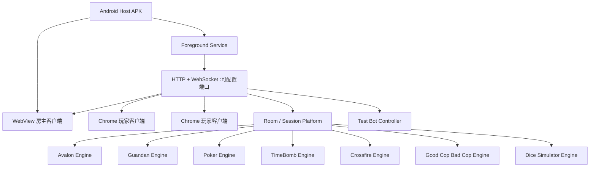
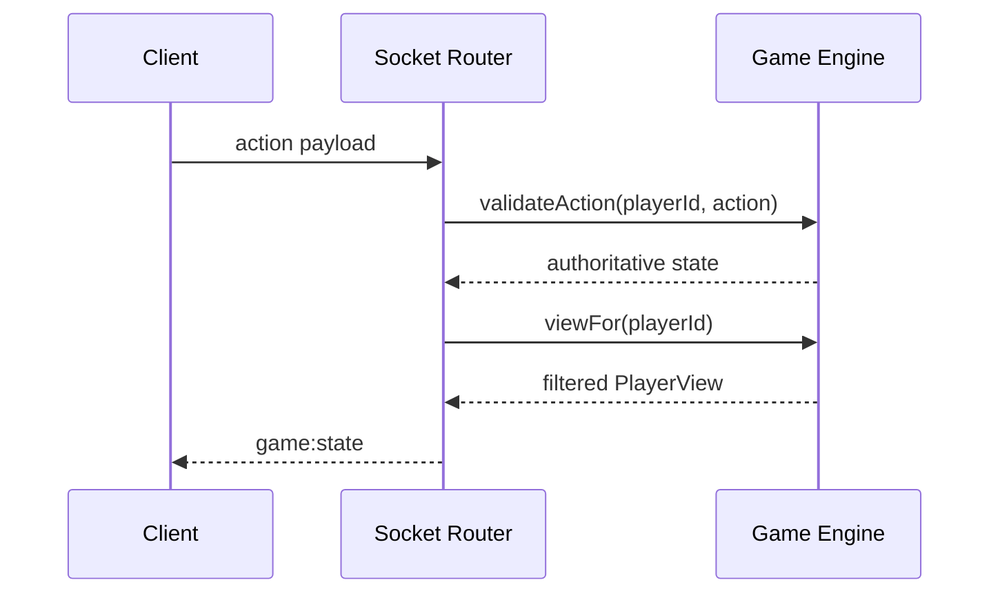

# 技术架构

## 运行拓扑

所有客户端都运行同一份 React 应用。房主 WebView 通过保存的端口连接 `127.0.0.1`；其他手机使用房主在部署页选择的局域网 IPv4 和端口。部署上线时服务器绑定 `0.0.0.0`；未部署或主动关闭部署时仅绑定 `127.0.0.1`。没有 LAN IP 时，房主客户端仍可通过 Loopback 创建仅本机房间。业务状态只存在于房主服务器。

## 模块职责

| 模块 | 职责 | 不负责 |
| --- | --- | --- |
| Android Activity | WebView、启动就绪探测、失败重试、系统返回键 | 游戏规则 |
| Foreground Service | 本地服务器生命周期、端口回退、网络变化监听、部署设置和服务保活 | 游戏 UI 状态 |
| LocalGameServer | 静态资源、WebSocket、协议路由、二维码 | 规则判断 |
| RoomManager | 房间、玩家、房主权限、Session 索引 | 游戏内部阶段 |
| AvalonGame | 身份、可见信息、组队、投票、任务、刺杀 | 网络和 UI |
| GuandanGame | 两副牌、标准常用牌型比较、轮流出牌、搭档胜负 | 网络和 UI |
| PokerGame | 发牌、行动顺序、下注街道、结算 | 网络和 UI |
| TimeBombGame | 阵营、线路池、剪线、轮次和胜负 | 网络和 UI |
| CrossfireGame | 有限情报、讨论、同时目标和结算 | 网络和 UI |
| GoodCopBadCopGame | 身份牌、调查、装备、枪械和淘汰 | 网络和 UI |
| LiarDiceGame | 骰子模拟器的统一骰数配置、私密骰子、全量重掷、结算和结果统计 | 网络和 UI |
| TestBotController | 未部署服务器的等待大厅测试机器人调度，调用现有游戏动作 | 正式玩家身份和复杂 AI |
| React Client | 展示 PlayerView、收集玩家动作 | 权威状态和秘密数据 |

## 隐私边界

阿瓦隆角色、德州牌堆、TimeBomb 线路、Good Cop Bad Cop 隐藏身份和骰子模拟器私密骰子从不序列化到公共状态。`viewFor(playerId)` 是唯一发往对应玩家的游戏视图。Crossfire 在统一结算前也不会公开其他玩家目标。

测试机器人没有 WebSocket 连接，使用虚拟 Player ID 进入正常游戏实例；控制器只调用与真人相同的规则方法，再由 LocalGameServer 通过现有 `room:state`/`game:state` 广播。服务器部署上线时控制器停止调度，`room:bots` 和含机器人房间的启动请求也会被服务端拒绝。

## 重连

浏览器保存 `sessionId + playerId + roomId + nickname`。WebSocket 断开后使用应用层心跳和指数退避重新连接；重新发送 `room:join` 时，RoomManager 优先通过 Session 索引恢复原玩家。若用户已清除本地 Session，服务器会在离线玩家中按不区分大小写的昵称匹配并换发 Session，保留原 `playerId` 及游戏引擎状态。

房主通过 `room:leave` 返回主界面时，RoomManager 删除房间、游戏实例和全部 Session 索引，并向其他连接广播 `room:closed`。普通玩家在等待大厅退出时只移除本人；游戏中主动退出会保留离线座位，避免直接破坏运行中的权威游戏状态。

服务器分别维护房间和 Session 的 Socket 集合。同一 Session 因刷新或短暂重连同时存在多个 Socket 时，只有最后一个连接关闭才会把玩家标记为离线；创建新房间会生成新的 Session，避免旧房间身份串用。NanoHTTPD listener 不再给升级后的 WebSocket 套用 5 秒读超时。

## 局域网发现

Android 同时读取 `ConnectivityManager` 的 `LinkProperties/NetworkCapabilities` 与 `NetworkInterface`，合并后只保留 RFC1918 IPv4。Wi-Fi 和 Ethernet 优先，VPN、Cellular、Loopback、Link-local 与 Wi-Fi Direct 被排除；候选网络不需要具备互联网或 `NET_CAPABILITY_VALIDATED`。`NetworkCallback` 触发重新发现，React 房主页和大厅也会轮询健康接口刷新部署/分享状态。

## 德州下注模型

- `streetBet`：当前街投入；
- `totalBet`：本手累计投入；
- `currentBet`：当前需要匹配的街下注；
- `minRaiseIncrement`：最后一次完整加注的增量；
- `pendingToAct`：本轮仍需回应的玩家；
- `raiseAllowed`：当前仍有权加注的玩家，用于正确处理短码 All-in 不重新开放加注；
- Side Pot 按所有不重复的累计投入层级拆分，Fold 玩家筹码计入池但不具有获奖资格。

## 进程与数据生命周期

第一版使用内存状态，避免数据库和迁移复杂度。房间结束或进程退出即释放。未来如需“房主进程恢复”，可在 Platform 层添加版本化快照接口，将无秘密泄漏风险的完整服务端状态写入 Room/SQLite。
